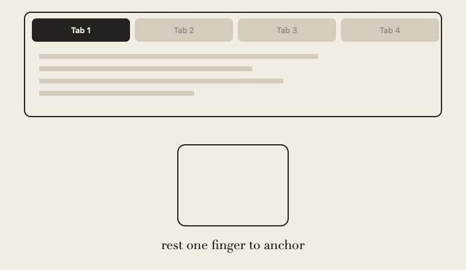
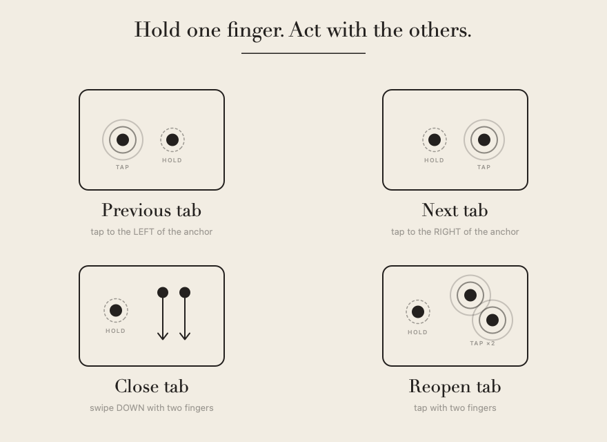

<p align="center">
  
</p>

<h1 align="center">OnTouch</h1>

<p align="center">
  Jitouch-style <b>anchored trackpad gestures</b> for switching and closing
  browser tabs on macOS.
</p>

<p align="center">
  
</p>

A tiny menu-bar app that reads raw finger data from Apple's private
`MultitouchSupport.framework` (the same approach Jitouch used) and posts keyboard
shortcuts to the active supported app when its window is under your cursor.

## Gestures

Every gesture is **anchored**: hold one finger still, then act with your other
finger(s). This is what keeps them from colliding with macOS's built-in
swipes. Defaults:

<p align="center">
  
</p>

| Hold a finger, then… | Action |
| --- | --- |
| **tap left** with one finger | Previous tab |
| **tap right** with one finger | Next tab |
| **swipe down** with two fingers | Close tab |
| **tap** with two fingers | Reopen closed tab |

The defaults focus on switching + closing tabs. Single-finger *swipes*
(back/forward/reload) are left out by default because they collide with
two-finger scrolling — add them in your config if you want them.

By default gestures work in **browsers + Finder**. Actions resolve for the active
app: Safari and Finder use Control-Tab to switch tabs; Chrome uses
Command-Option-Right/Left. Finder supports switching, closing, and creating tabs,
back/forward, and new windows. Browser-only named actions do nothing in Finder.
Set `targetBundleIDs` to `["*"]` to act in every app, or list specific bundle IDs.
Several safeguards keep gestures from
interfering with normal use:

- **Single instance** — launching another copy from a different folder exits
  the duplicate before it starts reading gestures. Keep the installed copy in
  `/Applications` so the login LaunchAgent starts that same app.
- **Active-app + pointer guard** — for scoped bindings, the window under the
  cursor must belong to the active target app. If a different app is active,
  pointing at a browser or Finder window does nothing; activate its app first.
  Within the same app, shortcuts affect its focused window. Shortcuts are sent
  directly to the validated process. The pointer guard is disabled for `["*"]` or an
  empty app list, which explicitly targets the active app without pointer checks.
- **Typing guard** — gestures pause for `typingGuard` seconds after any key
  press, so a stray touch can't fire shortcuts while you type.
- **Scroll guard** — taps pause for `scrollGuard` seconds after scrolling, so a
  touch between scroll strokes isn't mistaken for a tab switch.
- **Palm/thumb rejection** — touches that start in an edge strip (a thumb parked
  on the trackpad while your hand rests on the keyboard) count as neither anchor
  nor acting finger. Tunable via `sideEdgeZone`, `topEdgeZone`, `anchorEdgeZone`.
- **Click suppression** — while a configured gesture can act in the current app,
  OnTouch swallows its "tap to click". Unsupported actions and unrelated apps
  keep their clicks. Mouse releases are suppressed only when the matching press
  was suppressed, so a gesture starting during a normal drag keeps its release.

Every binding is editable — see [Custom gestures](#custom-gestures).

## Custom gestures

Copy [`config.example.json`](config.example.json) to
`~/.config/trackpad-tabs/config.json` and edit it (no rebuild needed — restart
the app to reload). Each binding looks like:

```json
{ "anchor": true, "fingers": 2, "type": "swipe", "direction": "up", "action": "newTab" }
```

| Field | Values |
| --- | --- |
| `anchor` | `true` = hold one finger as an anchor (recommended) |
| `fingers` | number of *acting* fingers (anchor not counted): `1`, `2`, `3` |
| `type` | `"tap"` or `"swipe"` |
| `direction` | tap → position vs. the anchor: `left`/`right`/`up`/`down`/`any`<br>swipe → `left`/`right`/`up`/`down` |
| `action` | a built-in name **or** any key chord like `"cmd+shift+t"` |
| `apps` | *(optional)* bundle IDs this binding applies to; defaults to `targetBundleIDs` |

Bindings are checked in order: the first matching gesture pattern is selected,
then its app scope is checked. A rejected binding does not fall through to a
later duplicate pattern. Use the named app-aware actions for common gestures.

**Built-in actions:** `nextTab`, `prevTab`, `closeTab`, `newTab`, `reopenTab`,
`closeWindow`, `reload`, `back`, `forward`, `newWindow`, `privateWindow`,
`showAllTabs`, `zoomIn`, `zoomOut`, `firstTab`. Anything else is parsed as a key
chord (`cmd`/`shift`/`ctrl`/`alt` + a key), so you can trigger *any* menu command
in *any* app — e.g. `{"...": "...", "action": "cmd+l"}` to focus the address bar.

| Action | Finder | Safari | Chrome |
| --- | --- | --- | --- |
| Previous/next tab | Control-Shift-Tab / Control-Tab | Control-Shift-Tab / Control-Tab | Command-Option-Left / Right |
| Close tab | Command-W | Command-W | Command-W |
| New tab | Command-T | Command-T | Command-T |
| Reopen closed tab | Unavailable | Command-Shift-T | Command-Shift-T |
| Back/forward | Command-[ / ] | Command-[ / ] | Command-[ / ] |
| New window | Command-N | Command-N | Command-N |

Closing the last tab can close its window. Finder rejects other built-in names,
including `reload`, `privateWindow`, and `firstTab`, because their browser
shortcuts trigger unrelated Finder commands. An explicit chord such as
`cmd+shift+t` remains a user override, so choose its app scope carefully.
`showAllTabs` retains Safari's overview shortcut; Chrome's Tab Search is a
different command (`cmd+shift+a`) and can be configured as a literal chord.

Shortcut references: [Apple Finder/macOS](https://support.apple.com/en-us/102650),
[Safari](https://support.apple.com/guide/safari/keyboard-shortcuts-and-gestures-cpsh003/mac),
[Chrome](https://support.google.com/chrome/answer/157179?hl=en).

## Build & run

```sh
./build.sh        # compiles + assembles OnTouch.app (ad-hoc signed)
open OnTouch.app
```

Or run in the foreground to watch logs (`./run.sh`). The app lives in the menu
bar ("On" wordmark); there is no Dock icon.

> **Can't see the menu-bar item?** On MacBooks with a notch, menu-bar icons can
> hide *behind the notch* when the bar is crowded. Quit some other menu-bar apps,
> or use a menu-bar manager (e.g. Bartender/Ice) to reveal it. The "OnTouch"
> text label makes it easier to spot.

## Install & run at login

Copy the app into `/Applications` and register a LaunchAgent so it starts
automatically each time you log in:

```sh
./build.sh
cp -R OnTouch.app /Applications/
cp com.local.ontouch.plist ~/Library/LaunchAgents/
launchctl load -w ~/Library/LaunchAgents/com.local.ontouch.plist
```

To stop it autostarting:

```sh
launchctl unload -w ~/Library/LaunchAgents/com.local.ontouch.plist
rm ~/Library/LaunchAgents/com.local.ontouch.plist
```

## Permissions (first launch)

macOS will prompt for two permissions. Grant both; OnTouch checks for permission
changes and starts its input services when access becomes available. The menu
shows Accessibility and Input Monitoring status separately from the gesture toggle.

1. **Accessibility** — lets the app post keystrokes to Safari.
   System Settings → Privacy & Security → Accessibility.
2. **Input Monitoring** — lets it read raw multitouch data.
   System Settings → Privacy & Security → Input Monitoring.

The menu has shortcuts to open both panes. Add `OnTouch.app` and toggle it on.

> Local builds are ad-hoc signed. A changed build can invalidate an earlier
> permission grant even with the same bundle identifier `com.local.ontouch`.
> If a replaced build reports missing access while System Settings shows it on,
> turn its grant off and on, or remove the stale entry and add the installed
> `/Applications/OnTouch.app` again.

For troubleshooting, OnTouch writes status logs under subsystem
`com.local.ontouch`: permission results, device startup, first touch-frame receipt,
recognized actions, and target-app decisions. These entries contain no typed text,
window titles, file names, or touch positions.

## Tuning

Recognition thresholds live in `Sources/OnTouch/Config.swift`. To change them
without rebuilding, create `~/.config/trackpad-tabs/config.json` with any subset
of keys, e.g.:

```json
{
  "swipeDownDist": 0.08,
  "tapMaxDuration": 0.40,
  "targetBundleIDs": ["com.apple.Safari", "com.google.Chrome"]
}
```

Distances are normalized trackpad units (0–1); times are in seconds.

## How it works

- `CMultitouch` — C shim declaring the private MT API and linking the framework.
- `MultitouchReader` — opens every MT device and streams frames via a C callback.
- `GestureEngine` — tracks finger contacts, identifies a held *anchor* finger,
  and recognizes taps (left/right of the anchor) and two-finger down-swipes.
- `ActionRunner` — posts the mapped keyboard shortcut, but only when the window
  under the cursor belongs to a target app.
- `TypingMonitor` / `ScrollMonitor` — pause gestures while you type or scroll.
- `ClickSuppressor` — event tap that drops the click a gesture-tap would cause.
- `AppDelegate` — menu-bar UI, enable/disable toggle, permission shortcuts.

The images in `docs/` are generated, not screenshots — regenerate them with:

```sh
swift tools/make_demo_gif.swift        # docs/demo.gif
swift tools/make_gesture_guide.swift   # docs/gestures.png
swift tools/make_final.swift           # app icon source (ivory + noir)
```

## Sharing with others

Because OnTouch reads a private framework and posts keystrokes, it can't go on
the Mac App Store, but you can still share it:

- **Source (this repo)** — anyone can clone and `./build.sh`. Zero cost.
- **Send the `.app` to a friend** — zip `OnTouch.app` and send it. Since it
  isn't signed by an Apple Developer ID, macOS Gatekeeper will block the first
  open. They right-click the app → **Open** → **Open** (only needed once), then
  grant Accessibility + Input Monitoring. Heads-up: each person must do this.
- **Polished public release** — requires the Apple Developer Program ($99/yr) to
  get a Developer ID certificate, then **sign + notarize** the app so Gatekeeper
  trusts it. Distribute as a `.dmg` or zip, or via a Homebrew cask.

## Credits

OnTouch is an independent project, written from scratch. It was inspired by and
learned from these excellent open-source projects (no code was copied from
either):

- [**Jitouch**](https://github.com/sukolsak/jitouch) — the original trackpad
  gesture utility whose "hold an anchor finger, act with another" interaction
  model this app reproduces. Jitouch is GPLv3; OnTouch shares none of its source.
- [**pqrs-org/osx-event-observer-examples**](https://github.com/pqrs-org/osx-event-observer-examples)
  — reference for the macOS event-observer permission model (Input Monitoring /
  Accessibility).

The `MultitouchSupport.framework` struct layout used here is reverse-engineered
public knowledge reproduced across many open-source multitouch readers.

## License

[MIT](LICENSE) — do whatever you like, just keep the copyright notice. Remember
to put your name in the `LICENSE` file.

## Caveats / next steps

- If a tap accidentally triggers macOS two-finger secondary-click, disable
  "two-finger secondary click" or tune `tapMaxDuration` down.
- "Close all" is wired in `ActionRunner` (Cmd-Shift-W) but not yet bound to a
  gesture — easy to add (e.g. anchor + three-finger swipe down).
- Multi-app support: add bundle IDs to `targetBundleIDs`. Tab shortcuts differ
  per browser.
